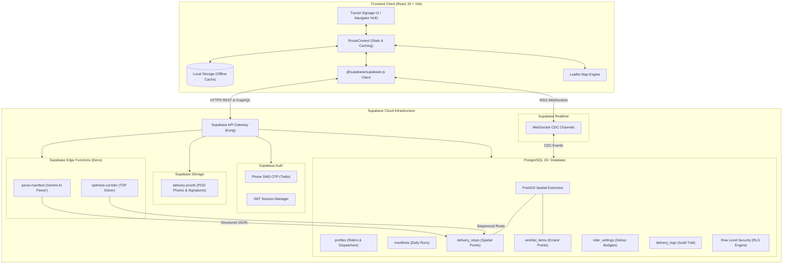

# 🚖 RouteWala (रूटवाला / रुटवाला)

> **Next-Generation Urban Transit Navigator & Dispatch Optimizer for Hyper-Local Delivery Workers in Mumbai**  
> *Engineered for high-density congestion, midday sun glare, monsoon rains, one-handed thumb operation, and seamless on-the-way errand pitstops.*

---

[](https://react.dev/)
[](https://www.typescriptlang.org/)
[](https://vitejs.dev/)
[](https://tailwindcss.com/)
[](https://supabase.com/)
[](https://postgis.net/)
[](https://leafletjs.com/)
[](https://ai.google.dev/)
[](#-mobile-ergonomics--touch-architecture)
[](LICENSE)

---

## 📑 Table of Contents

1. [Executive Overview & Problem Statement](#-executive-overview--problem-statement)
2. [Key Architecture & Full-Stack Capabilities](#-key-architecture--full-stack-capabilities)
3. [Feature Walkthrough (All 8 Modules)](#-feature-walkthrough-all-8-modules)
   - [1. Landing Page (`/`)](#1-landing-page-)
   - [2. Manifest Planner (`/plan`)](#2-manifest-planner-plan)
   - [3. Route Sequencer & Transit Map (`/route`)](#3-route-sequencer--transit-map-route)
   - [4. Transit Navigator HUD (`/go`)](#4-transit-navigator-hud-go)
   - [5. On-The-Way Wishlist & Pitstop Radar (`/wishlist`)](#5-on-the-way-wishlist--pitstop-radar-wishlist)
   - [6. Day Summary & Earnings Dashboard (`/summary`)](#6-day-summary--earnings-dashboard-summary)
   - [7. Rider Settings & Ergonomics (`/settings`)](#7-rider-settings--ergonomics-settings)
   - [8. Transit Design System Specification (`/design`)](#8-transit-design-system-specification-design)
4. [Supabase Backend Architecture & How It Is Used](#-supabase-backend-architecture--how-it-is-used)
   - [Why Supabase?](#why-supabase-for-routewala)
   - [System Architecture Diagram](#system-architecture-diagram)
   - [Authentication (Phone SMS OTP & Email)](#1-authentication-phone-sms-otp--email)
   - [Database & PostGIS Geospatial Engine](#2-database--postgis-geospatial-engine)
   - [Complete Production Database Schema (SQL DDL)](#3-complete-production-database-schema-sql-ddl)
   - [Row-Level Security (RLS) Policies](#4-row-level-security-rls-policies)
   - [PostGIS Stored Procedures for Corridor Pitstops](#5-postgis-stored-procedures-for-corridor-pitstops)
   - [Realtime Channels & Change Data Capture (CDC)](#6-realtime-channels--change-data-capture-cdc)
   - [Supabase Storage for Proof of Delivery (POD)](#7-supabase-storage-for-proof-of-delivery-pod)
   - [Supabase Edge Functions](#8-supabase-edge-functions)
5. [Frontend Client Integration](#-frontend-client-integration)
6. [Design System & Visual Language](#-design-system--visual-language)
7. [Project Directory Structure](#-project-directory-structure)
8. [Getting Started & Local Development](#-getting-started--local-development)
9. [Deployment Guide](#-deployment-guide)
10. [Roadmap & Contributing](#-roadmap--contributing)

---

## 🧭 Executive Overview & Problem Statement

Hyper-local delivery riders in dense Indian megacities—like the arterial corridors of **Mumbai (Dadar, Lower Parel, Byculla, BKC, Bandra, Kurla, Colaba)**—face punishing on-ground conditions:

```
┌─────────────────────────────────────────────────────────────────────────────────┐
│                           ON-GROUND RIDER REALITIES                             │
├───────────────────────────────┬─────────────────────────────────────────────────┤
│ 1. Congested Multi-Stop Runs  │ 25-40 drops per shift with strict SLA windows   │
│ 2. Intense Midday Sun Glare   │ 38°C sunlight washing out modern subtle UI apps │
│ 3. Rain, Sweat & Vibrations   │ Monsoon downpours make delicate tap targets fail│
│ 4. Personal Errands Penalty   │ Missing a medicine run because routes are rigid │
│ 5. Cash-on-Delivery (COD)     │ Reconciling loose cash and parcel commissions   │
│ 6. Spotty Mobile Data         │ Concrete urban canyons causing connection loss  │
│ 7. Trilingual Workforce       │ Delivery workers speaking Marathi, Hindi, & Eng │
└───────────────────────────────┴─────────────────────────────────────────────────┘
```

**RouteWala** was purpose-built to solve these realities. Instead of another consumer navigation app, RouteWala is an **industrial transit companion**:
- **Transit Signage Aesthetic**: Inspired by Mumbai's iconic suburban railway signage and BEST bus indicators—bold typography, brutalist ticket-stub geometry, and high-visibility contrast.
- **56px Touch Standard**: All primary controls meet or exceed a minimum 56px touch target height, engineered for one-handed operation on motorcycle phone mounts while wearing riding gloves or navigating monsoon rain.
- **On-The-Way Wishlist & Pitstop Radar**: Enables riders to log personal errands (pharmacies, ATMs, chai stalls, tiffin pickups) and calculates proactive detour budgets so riders never miss an SLA or sacrifice personal needs.
- **Daylight High-Contrast Mode**: Inverts interface into pure black/white ink for direct sunlight legibility.
- **Trilingual Localization**: Native zero-latency toggling between English (`en`), Hindi (`hi`), and Marathi (`mr`).
- **Offline-First Resilience**: All active stops and manifest states synchronize via local persistence and reconcile to Supabase when reconnected.

---

## ⚡ Key Architecture & Full-Stack Capabilities

```
┌────────────────────────────────────────────────────────────────────────┐
│                        ROUTEWALA FULL-STACK STACK                      │
├───────────────────────────────────┬────────────────────────────────────┤
│ Client Layer                      │ React 19, TypeScript, Vite 6       │
│ Styling & Motion                  │ Tailwind CSS v4, Motion, CSS Vars  │
│ Mapping & Geospatial Tiles        │ Leaflet 1.9, OpenStreetMap         │
│ Iconography & Typography          │ Lucide React, Bricolage Grotesque, │
│                                   │ Instrument Sans, IBM Plex Mono     │
│ AI Intelligence                   │ Google Gemini 2.4 Flash SDK        │
│ Backend-as-a-Service (BaaS)       │ Supabase Cloud                     │
│ Primary Database                  │ PostgreSQL 15+ with PostGIS        │
│ Auth Provider                     │ Supabase Auth (Phone SMS OTP)      │
│ Realtime Engine                   │ Supabase Realtime (WebSockets)     │
│ Cloud Storage                     │ Supabase Storage (POD photos)      │
│ Serverless Edge Compute           │ Supabase Edge Functions (Deno)     │
└───────────────────────────────────┴────────────────────────────────────┘
```

---

## 🚀 Feature Walkthrough (All 8 Modules)

### 1. Landing Page (`/`)
- **Hero & Dispatch Billboard**: Features dynamic Mumbai transit punchlines, real-time live manifest badge, and quick access buttons.
- **Problem vs. RouteWala Comparison**: Visual side-by-side breakdowns highlighting how generic consumer navigation fails delivery riders and how RouteWala fixes it.
- **Feature Showcase Grid**: Interactive overview of the 6 core pillars (Corridor Optimization, On-The-Way Radar, Sunlight Contrast, 56px Glove Touch, Cash Tracker, Offline Engine).
- **Rider Testimonials & Community Voice**: Feedback quotes from gig riders across Mumbai delivery hubs.

### 2. Manifest Planner (`/plan`)
- **Single Stop Entry**: Rapid address form with instant Area & Landmark selection.
- **Curated Mumbai Landmark Database**: Autocomplete matching over 30 iconic Mumbai drop landmarks (e.g., Dadar Plaza Cinema, Lower Parel Palladium Dock, BKC Diamond Bourse, Byculla Sarvi).
- **AI & Regex Bulk Manifest Parser (Paste Modal)**:
  - Riders or dispatchers can copy-paste messy WhatsApp texts, dispatch logs, or SMS manifests.
  - Automatically parses recipient names, phone numbers, addresses, priorities, parcel counts, and COD values using regex and Gemini AI parsing.
- **Interactive Leaflet Map Picker Modal**: Pinpoint exact latitude/longitude coordinates on a high-resolution map with draggable marker pins.
- **Edit Stop Bottom Sheet**: Touch-optimized bottom drawer to update priority, parcel count, COD amount, recipient details, and instructions on the fly.
- **Preset Demo Day Loader**: One-click button to load a realistic 7-stop Mumbai delivery run spanning Dadar, Lower Parel, Byculla, and Colaba.

### 3. Route Sequencer & Transit Map (`/route`)
- **Smart Optimization Engine**:
  - Automatically calculates optimal route order using a North-to-South Mumbai arterial corridor sweep heuristic.
  - Ensures **Pickups** precede linked **Drops** (`pairedStopId`).
  - Prioritizes **High Priority** time-critical packages first, then clusters geographically to minimize fuel and U-turns.
- **Priority Mode Toggles**:
  - **Smart Mode**: Balances high-priority deadlines with directional corridor efficiency.
  - **Strict Mode**: Forces all urgent SLA deliveries first regardless of distance.
  - **Manual Drag-and-Drop Mode**: Direct reordering with accessible grab handles.
- **Interactive Transit Polyline Map**:
  - Rendered with Leaflet and grayscale OSM transit tiles.
  - Color-coded sequential route polylines with directional arrows.
  - Numbered pin markers indicating pending, active, and completed stops.
- **Stop Inspector Sheet**: Sliding bottom drawer for inspecting delivery details, recipient contacts, and gate instructions.

### 4. Transit Navigator HUD (`/go`)
- **One-Handed Driver Console**: Minimalist, distraction-free display designed for handlebar phone mounts.
- **Horizontal Progress Rail**: Live transit progress bar showing completed, current, and upcoming stops with quick navigation jumps.
- **Glanceable Active Stop Card**:
  - Massive address and landmark callouts visible at arm's length.
  - Chamfered octagonal priority shield (`High`, `Medium`, `Low`).
  - 1-tap phone dialing link (`tel:...`) to call the customer directly without leaving the app.
  - 1-tap external turn-by-turn navigation link launching native Google Maps / Apple Maps.
- **Massive 56px Action Triggers**:
  - `Mark Delivered`: Advances sequence, registers completed status, and logs COD collections.
  - `Can't Deliver`: Opens the reason bottom sheet.
- **"Can't Deliver" Bottom Sheet**: Captures on-ground delivery failure exceptions:
  - `Customer Unreachable`
  - `Door Locked / Nobody Home`
  - `Cash Not Ready (COD)`
  - `Wrong Address / Security Denied Entry`
- **8-Second Undo Action Snackbar**: Protects against accidental screen taps caused by road bumps, rain droplets, or vibrations, allowing riders to undo completions or skips instantly.
- **End-of-Day Celebration Modal**: Gamified congratulatory screen celebrating 100% completion with delivery statistics and total earnings.

### 5. On-The-Way Wishlist & Pitstop Radar (`/wishlist`)
- **Personal Errand Engine**: Delivery workers can log personal tasks across 7 categories:
  - 🛍️ **Shop** (e.g., buying running shoes, general store items)
  - 💊 **Pharmacy** (e.g., picking up blood pressure medicines)
  - 💳 **ATM** (e.g., cash withdrawals before banks close)
  - 🍲 **Food** (e.g., picking up tiffin boxes, street food snacks)
  - ⛽ **Fuel** (e.g., refueling at Indian Oil / HP pump)
  - 🚻 **Restroom** (e.g., clean public restrooms along the corridor)
  - ☕ **Chai Stall** (e.g., quick 5-minute tea break)
- **Detour Budget Controls**:
  - Max Detour per Errand slider (0 to 10 minutes).
  - Total Daily Detour Budget slider (5 to 30 minutes).
  - Max Alerts per Day slider (1 to 5 notifications).
  - Quiet Mode While Moving toggle (silences non-critical prompts during active transit).
- **Proactive Pitstop Radar Banner**:
  - Automatically pops up when an errand is within corridor proximity:
    > *"On-The-Way Pitstop: Wellness Forever Dadar is 120m off your route (+2 min detour). Detour budget remaining: 13 min."*
  - **1-Tap Action**: `Add as Next Stop` dynamically injects the errand into the delivery itinerary without resetting the sequence.

### 6. Day Summary & Earnings Dashboard (`/summary`)
- **Daily Performance Scorecard**: High-impact metrics showing:
  - Total Stops, Completed Deliveries, Skipped/Failed Deliveries.
  - Total Parcels Delivered vs Manifest Count.
  - Kilometers Traveled and Time Saved.
- **Interactive Day Replay Map**: Leaflet map visualizing the entire completed transit trail across Mumbai.
- **Dynamic Rider Earnings Calculator**:
  - Base Fee per Stop (customizable, default ₹45/stop).
  - COD Collection Bonus (customizable percentage, default 2%).
  - Fuel Allowance per Kilometer (customizable, default ₹4/km).
  - Live Total Daily Earnings breakdown.
- **1-Tap Manifest Sharing**:
  - Formatted WhatsApp message generator for depot supervisor updates.
  - Native SMS dispatch report formatting.
- **Print & PDF Export**: Clean, print-styled tabular delivery manifest audit for depot check-in.

### 7. Rider Settings & Ergonomics (`/settings`)
- **Trilingual Language Selector**: Instant switching between:
  - English (`en`)
  - Hindi (`hi` - हिन्दी)
  - Marathi (`mr` - मराठी)
- **Daylight High-Contrast Mode**: Inverts interface into stark black/white ink for extreme ambient sunlight conditions.
- **Text Size Scaling**: Three accessibility tiers: `Normal`, `Large`, and `Extra Large`.
- **Vehicle Profile Selector**: Tailors routing preferences for `Motorcycle`, `Scooter`, `Electric Vehicle (EV)`, or `Bicycle`.
- **Privacy Shield & Background Telemetry Toggle**: Allows riders to block passive background location logging during off-duty hours.
- **Audio Feedback Toggle**: High-frequency chimes for delivery confirmations and route alerts.
- **Data Governance**: Reset to default Mumbai demo data or perform a complete offline data purge.

### 8. Transit Design System Specification (`/design`)
- Live interactive token catalog demonstrating all typography styles, color swatches, button states, chips, modals, bottom sheets, and the distinctive **Ticket-Stub** notched card aesthetic.

---

## 🗄️ Supabase Backend Architecture & How It Is Used

### 🔌 Connecting Supabase

To connect your existing Supabase project to RouteWala:

1. **Obtain Project Credentials**:
   - Go to your [Supabase Dashboard](https://supabase.com/dashboard) -> Select your project -> **Project Settings** -> **API**.
   - Copy the **Project URL** (`https://<project-ref>.supabase.co`).
   - Copy the **`anon` `public` key** (`eyJhbGciOi...`).
   > ⚠️ **SECURITY WARNING**: Never configure, print, or commit a `service_role` key in frontend code. Only the `anon` public key is ever used.

2. **Configure Environment Variables**:
   - Create or edit `.env.local` or `.env` in the project root:
     ```bash
     VITE_SUPABASE_URL="https://your-project-id.supabase.co"
     VITE_SUPABASE_ANON_KEY="your-anon-public-api-key"
     ```
   - `.env.local` and `.env` are automatically ignored by Git (see `.gitignore`).

3. **Existing Database Schema**:
   The RouteWala repository data layer (`src/data/repo/`) maps directly to your existing Supabase tables:
   - `profiles(id, display_name, language, vehicle_type)`
   - `user_settings(user_id, strict_priority, detour_budget_min, daily_detour_budget_min, max_alerts_per_day, quiet_mode, high_contrast, text_size, location_opt_in)`
   - `route_plans(id, user_id, title, plan_date, status, strict_priority, total_km, total_min, earnings, started_at, ended_at)`
   - `stops(id, plan_id, user_id, name, address, lat, lng, priority, deadline, type, pair_id, phone, cod_amount, note, sequence, eta, status, fail_reason, completed_at)`
   - `wishlist_items(id, user_id, text, category, place_name, lat, lng, detour_budget_min, status)`
   - `wishlist_prompts(id, user_id, plan_id, item_id, detour_m, detour_min, action, shown_at)`
   - RPC: `reorder_stops(p_plan uuid, p_ids uuid[])`

4. **Guest Mode vs. Logged-in Sync**:
   - If keys are not yet configured or user selects **"Continue as guest"**, RouteWala uses local storage with zero network dependencies.
   - When a rider logs in via **Phone SMS OTP**, **Magic Link**, or **Google OAuth**, RouteWala detects existing guest data and offers 1-tap **"Import to Cloud"**, moving all stops and wishlist items into Supabase.

---

### Why Supabase for RouteWala?

1. **Native PostGIS Geospatial Capabilities**: Standard databases cannot calculate spherical Earth distances or buffer zones along routes. Supabase's native PostGIS extension enables real-time spatial queries (`ST_DWithin`, `ST_Distance`) to identify off-route errands within a rider's detour budget.
2. **Phone Number SMS OTP Authentication**: Gig delivery workers in India rarely use corporate email; Supabase Auth supports instant SMS OTP via Twilio or MessageBird.
3. **Multi-Tenant Row-Level Security (RLS)**: Protects rider earnings, customer phone numbers, delivery addresses, and personal errand wishlists at the database kernel level.
4. **Realtime WebSockets (CDC)**: Dispatchers at central hubs can push emergency order cancellations, address corrections, or priority surges directly to active rider HUDs in real time without polling.
5. **Deno Edge Functions**: Provides low-latency serverless execution for route optimization algorithms and Gemini AI manifest parsing.

---

### System Architecture Diagram



---

### 1. Authentication (Phone SMS OTP & Email)

Delivery riders log in using their 10-digit Indian mobile number via SMS OTP, eliminating passwords and email requirements:

```typescript
import { supabase } from '../lib/supabase';

// 1. Send SMS OTP to Rider
export async function sendRiderOtp(phoneNumber: string) {
  const { data, error } = await supabase.auth.signInWithOtp({
    phone: `+91${phoneNumber}`,
  });
  if (error) throw error;
  return data;
}

// 2. Verify OTP Token
export async function verifyRiderOtp(phoneNumber: string, token: string) {
  const { data, error } = await supabase.auth.verifyOtp({
    phone: `+91${phoneNumber}`,
    token,
    type: 'sms',
  });
  if (error) throw error;
  return data.session;
}
```

Central depot dispatchers and managers can log in using standard Email Magic Links or Google OAuth.

---

### 2. Database & PostGIS Geospatial Engine

PostGIS provides true ellipsoidal math on the WGS 84 coordinate reference system (`SRID 4326`). Each stop and errand contains both explicit latitude/longitude columns and a generated PostGIS `GEOGRAPHY(Point, 4326)` column.

This allows RouteWala to execute blazing-fast spatial queries such as:
- Finding all wishlist errands within 500 meters of a delivery point: `ST_DWithin(errand.geom, stop.geom, 500)`
- Calculating straight-line detour distances in meters: `ST_Distance(errand.geom, stop.geom)`

---

### 3. Complete Production Database Schema (SQL DDL)

Execute this complete, production-ready SQL script in the **Supabase SQL Editor**:

```sql
-- ==============================================================================
-- ROUTEWALA PRODUCTION DATABASE SCHEMA FOR SUPABASE
-- ==============================================================================

-- 1. Enable Required Extensions
CREATE EXTENSION IF NOT EXISTS "uuid-ossp";
CREATE EXTENSION IF NOT EXISTS postgis;

-- 2. Create Enums
CREATE TYPE priority_level AS ENUM ('high', 'medium', 'low');
CREATE TYPE stop_type AS ENUM ('drop', 'pickup');
CREATE TYPE stop_status AS ENUM ('pending', 'in_progress', 'completed', 'skipped');
CREATE TYPE errand_category AS ENUM ('shop', 'pharmacy', 'atm', 'food', 'fuel', 'restroom', 'chai');
CREATE TYPE vehicle_type AS ENUM ('motorcycle', 'scooter', 'ev', 'bicycle');
CREATE TYPE app_language AS ENUM ('en', 'hi', 'mr');
CREATE TYPE text_size_option AS ENUM ('normal', 'large', 'xlarge');

-- 3. Profiles Table (Riders & Dispatchers)
CREATE TABLE IF NOT EXISTS public.profiles (
    id UUID PRIMARY KEY REFERENCES auth.users(id) ON DELETE CASCADE,
    phone VARCHAR(20) UNIQUE,
    full_name VARCHAR(100),
    vehicle_type vehicle_type DEFAULT 'motorcycle',
    preferred_language app_language DEFAULT 'en',
    rate_per_stop NUMERIC(10, 2) DEFAULT 45.00,
    cod_bonus_percent NUMERIC(5, 2) DEFAULT 2.00,
    fuel_allowance_per_km NUMERIC(10, 2) DEFAULT 4.00,
    created_at TIMESTAMPTZ DEFAULT NOW(),
    updated_at TIMESTAMPTZ DEFAULT NOW()
);

-- 4. Manifests Table (Daily Delivery Runs)
CREATE TABLE IF NOT EXISTS public.manifests (
    id UUID PRIMARY KEY DEFAULT uuid_generate_v4(),
    rider_id UUID NOT NULL REFERENCES public.profiles(id) ON DELETE CASCADE,
    title VARCHAR(150) NOT NULL DEFAULT 'Mumbai Central Corridor Run',
    manifest_date DATE NOT NULL DEFAULT CURRENT_DATE,
    status VARCHAR(20) NOT NULL DEFAULT 'active' CHECK (status IN ('drafting', 'active', 'completed')),
    total_stops INT DEFAULT 0,
    total_distance_km NUMERIC(6, 2) DEFAULT 0.0,
    total_cod_amount NUMERIC(12, 2) DEFAULT 0.0,
    collected_cod_amount NUMERIC(12, 2) DEFAULT 0.0,
    created_at TIMESTAMPTZ DEFAULT NOW(),
    updated_at TIMESTAMPTZ DEFAULT NOW()
);

-- 5. Delivery Stops Table (With PostGIS Point Geometry)
CREATE TABLE IF NOT EXISTS public.delivery_stops (
    id UUID PRIMARY KEY DEFAULT uuid_generate_v4(),
    manifest_id UUID NOT NULL REFERENCES public.manifests(id) ON DELETE CASCADE,
    rider_id UUID NOT NULL REFERENCES public.profiles(id) ON DELETE CASCADE,
    order_index INT NOT NULL,
    recipient_name VARCHAR(120) NOT NULL,
    phone VARCHAR(25),
    address TEXT NOT NULL,
    area VARCHAR(100) NOT NULL,
    landmark TEXT,
    priority priority_level NOT NULL DEFAULT 'medium',
    type stop_type NOT NULL DEFAULT 'drop',
    deadline VARCHAR(30),
    parcel_count INT NOT NULL DEFAULT 1,
    cod_amount NUMERIC(10, 2) NOT NULL DEFAULT 0.0,
    status stop_status NOT NULL DEFAULT 'pending',
    failure_reason TEXT,
    eta_minutes INT NOT NULL DEFAULT 15,
    distance_km NUMERIC(6, 2) NOT NULL DEFAULT 2.0,
    lat NUMERIC(10, 7) NOT NULL,
    lng NUMERIC(10, 7) NOT NULL,
    geom GEOGRAPHY(Point, 4326) GENERATED ALWAYS AS (ST_SetSRID(ST_MakePoint(lng, lat), 4326)::geography) STORED,
    notes TEXT,
    paired_stop_id UUID REFERENCES public.delivery_stops(id) ON DELETE SET NULL,
    pod_image_url TEXT,
    pod_signature_url TEXT,
    completed_at TIMESTAMPTZ,
    created_at TIMESTAMPTZ DEFAULT NOW(),
    updated_at TIMESTAMPTZ DEFAULT NOW()
);

-- 6. Wishlist Items Table (Personal Errands Along Route)
CREATE TABLE IF NOT EXISTS public.wishlist_items (
    id UUID PRIMARY KEY DEFAULT uuid_generate_v4(),
    rider_id UUID NOT NULL REFERENCES public.profiles(id) ON DELETE CASCADE,
    name VARCHAR(150) NOT NULL,
    category errand_category NOT NULL DEFAULT 'shop',
    landmark TEXT NOT NULL,
    area VARCHAR(100) NOT NULL,
    distance_off_route_meters INT DEFAULT 250,
    detour_minutes INT DEFAULT 3,
    detour_budget_minutes INT DEFAULT 5,
    rating NUMERIC(3, 1) DEFAULT 4.5,
    note TEXT,
    is_pinned BOOLEAN DEFAULT FALSE,
    lat NUMERIC(10, 7) NOT NULL,
    lng NUMERIC(10, 7) NOT NULL,
    geom GEOGRAPHY(Point, 4326) GENERATED ALWAYS AS (ST_SetSRID(ST_MakePoint(lng, lat), 4326)::geography) STORED,
    near_stop_id UUID REFERENCES public.delivery_stops(id) ON DELETE SET NULL,
    created_at TIMESTAMPTZ DEFAULT NOW(),
    updated_at TIMESTAMPTZ DEFAULT NOW()
);

-- 7. Rider Settings Table
CREATE TABLE IF NOT EXISTS public.rider_settings (
    rider_id UUID PRIMARY KEY REFERENCES public.profiles(id) ON DELETE CASCADE,
    detour_budget_per_errand INT DEFAULT 5 CHECK (detour_budget_per_errand BETWEEN 0 AND 10),
    total_daily_detour_budget INT DEFAULT 15 CHECK (total_daily_detour_budget BETWEEN 5 AND 30),
    max_alerts_per_day INT DEFAULT 3 CHECK (max_alerts_per_day BETWEEN 1 AND 5),
    quiet_mode_moving BOOLEAN DEFAULT FALSE,
    block_background_tracking BOOLEAN DEFAULT TRUE,
    text_size text_size_option DEFAULT 'normal',
    high_contrast BOOLEAN DEFAULT FALSE,
    sound_enabled BOOLEAN DEFAULT TRUE,
    created_at TIMESTAMPTZ DEFAULT NOW(),
    updated_at TIMESTAMPTZ DEFAULT NOW()
);

-- 8. Delivery Action Audit Logs
CREATE TABLE IF NOT EXISTS public.delivery_logs (
    id BIGSERIAL PRIMARY KEY,
    manifest_id UUID NOT NULL REFERENCES public.manifests(id) ON DELETE CASCADE,
    stop_id UUID NOT NULL REFERENCES public.delivery_stops(id) ON DELETE CASCADE,
    rider_id UUID NOT NULL REFERENCES public.profiles(id) ON DELETE CASCADE,
    action_type VARCHAR(30) NOT NULL, -- 'completed', 'skipped', 'failed', 'undone'
    failure_reason TEXT,
    recorded_at TIMESTAMPTZ DEFAULT NOW()
);

-- 9. Spatial and Performance Indexes
CREATE INDEX IF NOT EXISTS idx_stops_geom ON public.delivery_stops USING GIST(geom);
CREATE INDEX IF NOT EXISTS idx_wishlist_geom ON public.wishlist_items USING GIST(geom);
CREATE INDEX IF NOT EXISTS idx_stops_manifest_order ON public.delivery_stops(manifest_id, order_index);
CREATE INDEX IF NOT EXISTS idx_stops_status ON public.delivery_stops(status);
CREATE INDEX IF NOT EXISTS idx_manifests_rider_date ON public.manifests(rider_id, manifest_date);

-- 10. Automated Timestamp Update Triggers
CREATE OR REPLACE FUNCTION public.handle_updated_at()
RETURNS TRIGGER AS $$
BEGIN
    NEW.updated_at = NOW();
    RETURN NEW;
END;
$$ LANGUAGE plpgsql;

CREATE TRIGGER update_profiles_timestamp BEFORE UPDATE ON public.profiles FOR EACH ROW EXECUTE FUNCTION public.handle_updated_at();
CREATE TRIGGER update_manifests_timestamp BEFORE UPDATE ON public.manifests FOR EACH ROW EXECUTE FUNCTION public.handle_updated_at();
CREATE TRIGGER update_stops_timestamp BEFORE UPDATE ON public.delivery_stops FOR EACH ROW EXECUTE FUNCTION public.handle_updated_at();
CREATE TRIGGER update_wishlist_timestamp BEFORE UPDATE ON public.wishlist_items FOR EACH ROW EXECUTE FUNCTION public.handle_updated_at();
CREATE TRIGGER update_settings_timestamp BEFORE UPDATE ON public.rider_settings FOR EACH ROW EXECUTE FUNCTION public.handle_updated_at();
```

---

### 4. Row-Level Security (RLS) Policies

RouteWala enforces strict security policies guaranteeing that riders only see and modify their own delivery runs, earnings, and wishlists:

```sql
-- Enable RLS across all tables
ALTER TABLE public.profiles ENABLE ROW LEVEL SECURITY;
ALTER TABLE public.manifests ENABLE ROW LEVEL SECURITY;
ALTER TABLE public.delivery_stops ENABLE ROW LEVEL SECURITY;
ALTER TABLE public.wishlist_items ENABLE ROW LEVEL SECURITY;
ALTER TABLE public.rider_settings ENABLE ROW LEVEL SECURITY;
ALTER TABLE public.delivery_logs ENABLE ROW LEVEL SECURITY;

-- 1. Profiles: Riders can view and update only their own profile
CREATE POLICY "Riders can view own profile" ON public.profiles FOR SELECT USING (auth.uid() = id);
CREATE POLICY "Riders can update own profile" ON public.profiles FOR UPDATE USING (auth.uid() = id);

-- 2. Manifests: Riders manage their own manifests
CREATE POLICY "Riders manage own manifests" ON public.manifests FOR ALL USING (auth.uid() = rider_id);

-- 3. Delivery Stops: Riders manage stops in their own manifests
CREATE POLICY "Riders manage own stops" ON public.delivery_stops FOR ALL USING (auth.uid() = rider_id);

-- 4. Wishlist Items: Private to the individual rider
CREATE POLICY "Riders manage own wishlist" ON public.wishlist_items FOR ALL USING (auth.uid() = rider_id);

-- 5. Rider Settings: Private to the individual rider
CREATE POLICY "Riders manage own settings" ON public.rider_settings FOR ALL USING (auth.uid() = rider_id);

-- 6. Audit Logs: Riders can read and insert their own actions
CREATE POLICY "Riders manage own delivery logs" ON public.delivery_logs FOR ALL USING (auth.uid() = rider_id);
```

---

### 5. PostGIS Stored Procedures for Corridor Pitstops

Execute this PostgreSQL stored procedure to enable real-time detection of wishlist errands along the active delivery run:

```sql
-- ==============================================================================
-- Stored Procedure: Find Nearby Wishlist Pitstops
-- Identifies personal errands within max_detour_meters of the rider's current position
-- ==============================================================================
CREATE OR REPLACE FUNCTION public.find_nearby_wishlist_pitstops(
    p_rider_id UUID,
    p_current_lat NUMERIC,
    p_current_lng NUMERIC,
    p_max_detour_meters INT DEFAULT 500
)
RETURNS TABLE (
    id UUID,
    name VARCHAR,
    category errand_category,
    landmark TEXT,
    area VARCHAR,
    distance_meters INT,
    estimated_detour_minutes INT
) AS $$
DECLARE
    v_rider_point GEOGRAPHY;
BEGIN
    v_rider_point := ST_SetSRID(ST_MakePoint(p_current_lng, p_current_lat), 4326)::geography;

    RETURN QUERY
    SELECT 
        w.id,
        w.name,
        w.category,
        w.landmark,
        w.area,
        ROUND(ST_Distance(w.geom, v_rider_point))::INT AS distance_meters,
        GREATEST(1, ROUND(ST_Distance(w.geom, v_rider_point) / 200))::INT AS estimated_detour_minutes
    FROM public.wishlist_items w
    WHERE w.rider_id = p_rider_id
      AND ST_DWithin(w.geom, v_rider_point, p_max_detour_meters)
    ORDER BY distance_meters ASC
    LIMIT 3;
END;
$$ LANGUAGE plpgsql SECURITY DEFINER;
```

---

### 6. Realtime Channels & Change Data Capture (CDC)

RouteWala leverages Supabase Realtime to keep the rider's HUD synchronized with live fleet changes (e.g., dispatcher adds an urgent pickup, customer cancels delivery):

```typescript
import { supabase } from '../lib/supabase';

export function subscribeToManifestUpdates(manifestId: string, onUpdate: () => void) {
  const channel = supabase
    .channel(`manifest-${manifestId}`)
    .on(
      'postgres_changes',
      {
        event: '*',
        schema: 'public',
        table: 'delivery_stops',
        filter: `manifest_id=eq.${manifestId}`,
      },
      (payload) => {
        console.log('Realtime Stop Event received:', payload);
        onUpdate();
      }
    )
    .subscribe();

  return () => {
    supabase.removeChannel(channel);
  };
}
```

---

### 7. Supabase Storage for Proof of Delivery (POD)

RouteWala uses a secure Supabase Storage bucket (`delivery-proofs`) for photo proof of delivery and customer digital signatures:

1. Create a public or authenticated bucket named `delivery-proofs` in Supabase Storage.
2. Configure bucket RLS policies:

```sql
-- Storage Policy: Allow riders to upload POD images to their folder
CREATE POLICY "Riders upload delivery proofs"
ON storage.objects FOR INSERT
TO authenticated
WITH CHECK (bucket_id = 'delivery-proofs' AND (storage.foldername(name))[1] = auth.uid()::text);

-- Storage Policy: Allow riders to view their own uploaded proofs
CREATE POLICY "Riders view delivery proofs"
ON storage.objects FOR SELECT
TO authenticated
USING (bucket_id = 'delivery-proofs' AND (storage.foldername(name))[1] = auth.uid()::text);
```

3. Client Upload Code:

```typescript
export async function uploadProofOfDelivery(riderId: string, stopId: string, file: File) {
  const filePath = `${riderId}/${stopId}-${Date.now()}.jpg`;
  const { data, error } = await supabase.storage
    .from('delivery-proofs')
    .upload(filePath, file, { contentType: 'image/jpeg', upsert: true });

  if (error) throw error;
  
  const { data: publicData } = supabase.storage
    .from('delivery-proofs')
    .getPublicUrl(filePath);

  return publicData.publicUrl;
}
```

---

### 8. Supabase Edge Functions

RouteWala deploys two serverless Deno TypeScript Edge Functions in Supabase:

#### A. `parse-manifest` (Gemini AI Unstructured Text Parser)
- **Path**: `supabase/functions/parse-manifest/index.ts`
- **Purpose**: Ingests unstructured clipboard text (pasted WhatsApp manifests, SMS dumps), invokes Google Gemini 2.4 Flash, and returns structured JSON stop objects with validated Mumbai coordinates.

```typescript
// supabase/functions/parse-manifest/index.ts
import { serve } from 'https://deno.land/std@0.168.0/http/server.ts';
import { GoogleGenAI } from 'npm:@google/genai';

serve(async (req) => {
  const { rawText } = await req.json();
  const apiKey = Deno.env.get('GEMINI_API_KEY') || '';
  const ai = new GoogleGenAI({ apiKey });

  const response = await ai.models.generateContent({
    model: 'gemini-2.5-flash',
    contents: `Extract delivery stops from this unstructured manifest as JSON array:
    ${rawText}
    Format each item with: recipientName, address, area, landmark, phone, priority ('high'|'medium'|'low'), type ('drop'|'pickup'), codAmount, parcelCount.`,
  });

  return new Response(response.text, {
    headers: { 'Content-Type': 'application/json' },
  });
});
```

#### B. `optimize-corridor` (Corridor TSP Optimizer)
- **Path**: `supabase/functions/optimize-corridor/index.ts`
- **Purpose**: Computes the optimal Hamiltonian path along Mumbai's North-to-South western railway corridor, factoring in strict delivery deadlines and pickup dependencies.

---

## 💻 Frontend Client Integration

The frontend seamlessly connects to Supabase via `src/lib/supabase.ts`. If Supabase credentials are not configured in `.env`, RouteWala automatically falls back to local storage and mock databases, ensuring uninterrupted offline development.

```typescript
// src/lib/supabase.ts
import { createClient } from '@supabase/supabase-js';

const supabaseUrl = import.meta.env.VITE_SUPABASE_URL || '';
const supabaseAnonKey = import.meta.env.VITE_SUPABASE_ANON_KEY || '';

export const isSupabaseConfigured = Boolean(supabaseUrl && supabaseAnonKey);

export const supabase = createClient(
  supabaseUrl || 'https://placeholder.supabase.co',
  supabaseAnonKey || 'placeholder-anon-key',
  {
    auth: {
      persistSession: true,
      autoRefreshToken: true,
      detectSessionInUrl: true,
    },
    realtime: {
      params: { eventsPerSecond: 10 },
    },
  }
);
```

---

## 🎨 Design System & Visual Language

RouteWala implements an authentic **Indian Transit Signage Design System**:

```
┌────────────────────────────────────────────────────────────────────────┐
│                        COLOR TOKEN SPECIFICATION                       │
├─────────────────────┬───────────┬──────────────────────────────────────┤
│ Token Name          │ Hex Value │ Semantic Role                        │
├─────────────────────┼───────────┼──────────────────────────────────────┤
│ `--color-asphalt`   │ `#15171A` │ Dark tarmac header, wordmarks, footer│
│ `--color-taxi-yellow`│ `#F6B800`│ Mumbai Kaali-Peeli yellow, key CTAs  │
│ `--color-paper`     │ `#F4F1EA` │ Off-white newsprint paper canvas     │
│ `--color-paper-muted`│`#E8E4DA` │ Secondary backgrounds & borders      │
│ `--color-ink`       │ `#0E0E0E` │ High-contrast black body text        │
│ `--color-signal-red`│ `#D7372B` │ Urgent SLA / High-priority warning   │
│ `--color-amber-pri` │ `#E58A00` │ Medium-priority delivery badge       │
│ `--color-slate-teal`│ `#3E7C7A` │ Low-priority / Transit badge         │
│ `--color-success-green`│`#2E7D4F`│ Completed delivery confirmations    │
└─────────────────────┴───────────┴──────────────────────────────────────┘
```

### Typography Hierarchy

- **Display & Headings**: `Bricolage Grotesque` (Bold, tight-tracking railway billboard aesthetic).
- **Body & Street Addresses**: `Instrument Sans` (High legibility for Mumbai street addresses and Hindi/Marathi transliterations).
- **Codes, ETAs & Amounts**: `IBM Plex Mono` (Tabular monospace for timestamps, distances, phone numbers, and COD values).

### Tactile Brutalist Physics

- **Hard Offset Shadows**: `box-shadow: 4px 4px 0px #0E0E0E;`
- **Active Press State**: `transform: translate(2px, 2px);` with matching shadow collapse.
- **Ticket-Stub Cutouts**: Left and right circular notch pseudo-elements (`.ticket-stub::before`, `.ticket-stub::after`).
- **Chamfered Octagonal Shields**: Distinctive `clip-path: polygon(...)` shape for High-Priority deliveries to ensure color-blind accessibility.

---

## 📁 Project Directory Structure

```
RouteWala/
├── .env                              # Active environment variables (Gemini, Supabase)
├── .env.example                      # Configuration template
├── index.html                        # HTML entry point with Google Fonts preconnect
├── package.json                      # Project manifest & dependencies
├── tsconfig.json                     # TypeScript compiler configuration
├── vite.config.ts                    # Vite config with React & Tailwind plugins
│
├── src/
│   ├── main.tsx                      # React root entry point
│   ├── App.tsx                       # React Router configuration & Layout
│   ├── index.css                     # Tailwind v4 theme, CSS variables, & utilities
│   │
│   ├── context/
│   │   └── RouteContext.tsx          # Global route state, detour logic, & calculations
│   │
│   ├── lib/
│   │   └── supabase.ts               # Supabase client initialization & Database types
│   │
│   ├── i18n/
│   │   └── translations.ts           # Trilingual dictionaries (English, Hindi, Marathi)
│   │
│   ├── data/
│   │   ├── mockStops.ts              # Mumbai landmarks database, demo stops & coordinates
│   │   └── wishlistItems.ts          # Sample errands & category definitions
│   │
│   ├── pages/
│   │   ├── LandingPage.tsx           # Product showcase & marketing view (/)
│   │   ├── PlanPage.tsx              # Manifest creation & bulk paste parser (/plan)
│   │   ├── RoutePage.tsx             # Route sequencer & Leaflet transit map (/route)
│   │   ├── GoPage.tsx                # Driver navigation HUD (/go)
│   │   ├── WishlistPage.tsx          # On-The-Way pitstop radar & errand manager (/wishlist)
│   │   ├── SummaryPage.tsx           # Daily earnings & delivery replay report (/summary)
│   │   ├── SettingsPage.tsx          # Rider accessibility & app settings (/settings)
│   │   └── DesignSystemPage.tsx      # Token showcase & UI component library (/design)
│   │
│   └── components/
│       ├── layout/
│       │   ├── AppLayout.tsx         # Responsive container with mobile sticky bottom bar
│       │   └── Navbar.tsx            # Wordmark, nav links, language & contrast controls
│       │
│       ├── common/
│       │   ├── Button.tsx            # 56px touch-standard button primitive
│       │   ├── Chip.tsx              # Filter chip selector
│       │   ├── EmptyState.tsx        # Zero-data display with contextual action
│       │   ├── ErrorBoundary.tsx     # React component crash isolation
│       │   ├── Modal.tsx             # Accessible dialog container
│       │   ├── OfflineBanner.tsx     # Persistent transit network status banner
│       │   ├── PriorityBadge.tsx     # Chamfered octagonal priority indicators
│       │   ├── StopCard.tsx          # Ticket-stub delivery stop card with drag handles
│       │   └── Toggle.tsx            # Accessible tactile switch
│       │
│       ├── plan/
│       │   ├── EditStopBottomSheet.tsx # Mobile drawer for updating stops
│       │   ├── MapPickerModal.tsx     # Interactive Leaflet coordinate picker
│       │   └── PasteListModal.tsx     # WhatsApp / SMS bulk manifest text parser
│       │
│       ├── route/
│       │   └── TransitLeafletMap.tsx # Leaflet polyline map with custom numbered markers
│       │
│       ├── navigation/
│       │   ├── CantDeliverBottomSheet.tsx # Delivery failure reason picker
│       │   ├── EndOfDayCelebration.tsx   # Gamified 100% completion modal
│       │   ├── HorizontalProgressRail.tsx# Glanceable transit progress stepper
│       │   ├── OnTheWayPromptBanner.tsx  # Proactive detour pitstop notification
│       │   ├── PitstopRadarRow.tsx       # Live corridor errand radar ticker
│       │   └── UndoSnackbar.tsx          # 8-second safety undo bar
│       │
│       └── summary/
│           ├── DayReplayMap.tsx      # Full-day completed trail playback map
│           └── EarningsCalculator.tsx# Interactive base pay, COD & fuel payout engine
```

---

## 🛠️ Getting Started & Local Development

### Prerequisites

- **Node.js**: v18.0.0 or higher
- **npm**: v9.0.0 or higher
- **Supabase Account**: Free project created at [supabase.com](https://supabase.com)
- **Google AI Studio Key** *(Optional)*: For Gemini AI manifest parsing at [aistudio.google.com](https://aistudio.google.com/)

### Step 1: Clone the Repository

```bash
git clone https://github.com/your-username/routewalla.git
cd routewalla
```

### Step 2: Install Dependencies

```bash
npm install
```

### Step 3: Configure Environment Variables

Copy `.env.example` to `.env`:

```bash
cp .env.example .env
```

Open `.env` and provide your credentials:

```ini
# Supabase Configuration (from Supabase Dashboard -> Project Settings -> API)
VITE_SUPABASE_URL="https://xxxxxxxxxxxxxxxxxxxx.supabase.co"
VITE_SUPABASE_ANON_KEY="eyJhbGciOiJIUzI1NiIsInR5cCI6IkpXVCJ9..."

# Google Gemini AI Key (Optional - for AI WhatsApp manifest parsing)
GEMINI_API_KEY="AIzaSy..."

# Application Host URL
APP_URL="http://localhost:3000"
```

### Step 4: Run Database Migrations in Supabase

1. Open your Supabase Dashboard.
2. Navigate to the **SQL Editor**.
3. Copy the entire SQL script from [Section 3: Complete Production Database Schema](#3-complete-production-database-schema-sql-ddl).
4. Click **Run** to generate all tables, enums, PostGIS spatial indexes, and triggers.
5. *(Optional)* Run the RLS policies from [Section 4](#4-row-level-security-rls-policies) and stored procedure from [Section 5](#5-postgis-stored-procedures-for-corridor-pitstops).

### Step 5: Start Local Development Server

```bash
npm run dev
```

Open your browser at `http://localhost:3000` to interact with RouteWala.

### Step 6: Code Quality & Type Check

```bash
# Run TypeScript compilation check
npm run lint

# Build production bundle
npm run build

# Preview production build locally
npm run preview
```

---

## 🚢 Deployment Guide

### Deploying the Frontend (Vercel / Netlify / Cloudflare Pages)

RouteWala is a standard Vite Single Page Application (SPA):

#### Deploy via Vercel:
```bash
npm install -g vercel
vercel
```
Set the following environment variables in your Vercel Project Settings:
- `VITE_SUPABASE_URL`
- `VITE_SUPABASE_ANON_KEY`
- `GEMINI_API_KEY`

#### Deploy via Netlify:
Add a `_redirects` file in `public/_redirects`:
```
/*    /index.html   200
```
Build command: `npm run build`  
Publish directory: `dist`

### Deploying Supabase Edge Functions

Using the [Supabase CLI](https://supabase.com/docs/guides/cli):

```bash
# Log in to Supabase CLI
supabase login

# Link your local project to Supabase project
supabase link --project-ref your-project-ref

# Deploy the Edge Functions
supabase functions deploy parse-manifest
supabase functions deploy optimize-corridor
```

---

## 🗺️ Roadmap & Future Enhancements

- [ ] **Voice Turn-by-Turn in Hindi & Marathi**: Integrating Web Speech API for audible navigation instructions.
- [ ] **Bluetooth Handlebar Remote Support**: Web Bluetooth API integration allowing riders to advance stops via physical handlebar buttons without taking hands off grips.
- [ ] **Offline Vector Tiles PWA**: Caching OpenStreetMap vector tiles in IndexedDB for 100% offline map panning in underground parking basements.
- [ ] **Unified Multi-Platform Dispatch Import**: Pre-built webhooks accepting Zomato, Swiggy, Dunzo, Bluedart, and Delhivery manifest spreadsheets.

---

## 📜 License & Acknowledgments

This project is licensed under the **Apache-2.0 License**.

- **Typography**: [Bricolage Grotesque](https://fonts.google.com/specimen/Bricolage+Grotesque), [Instrument Sans](https://fonts.google.com/specimen/Instrument+Sans), [IBM Plex Mono](https://fonts.google.com/specimen/IBM+Plex+Mono).
- **Map Data**: [OpenStreetMap](https://www.openstreetmap.org/) contributors, [Leaflet.js](https://leafletjs.com/).
- **Design Inspiration**: The resilient, hardworking delivery workers of Mumbai and the iconic typography of Indian Railways and BEST bus routes.

